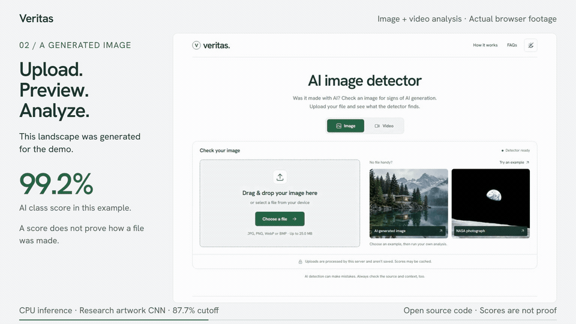
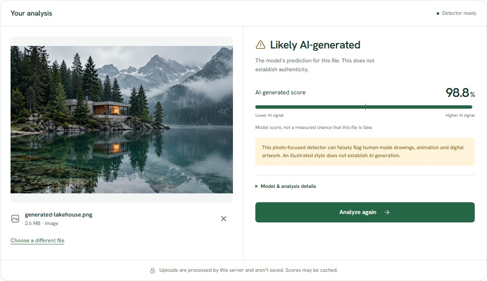
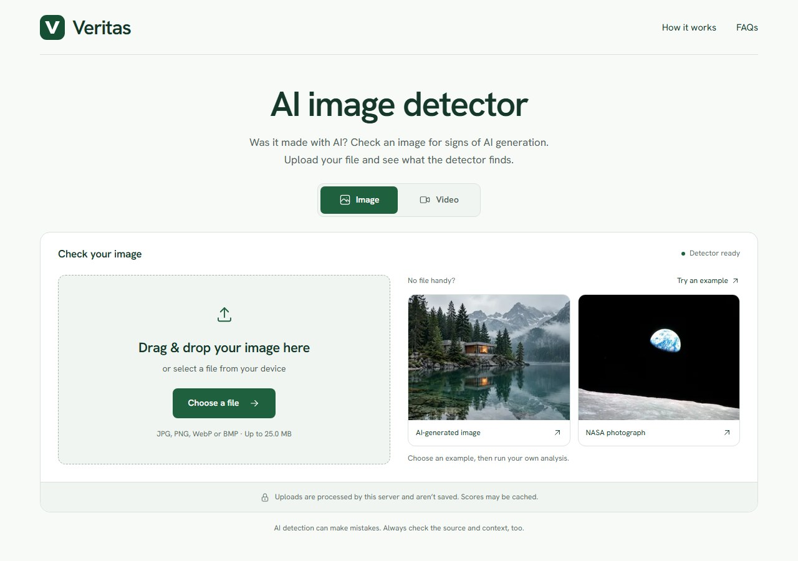
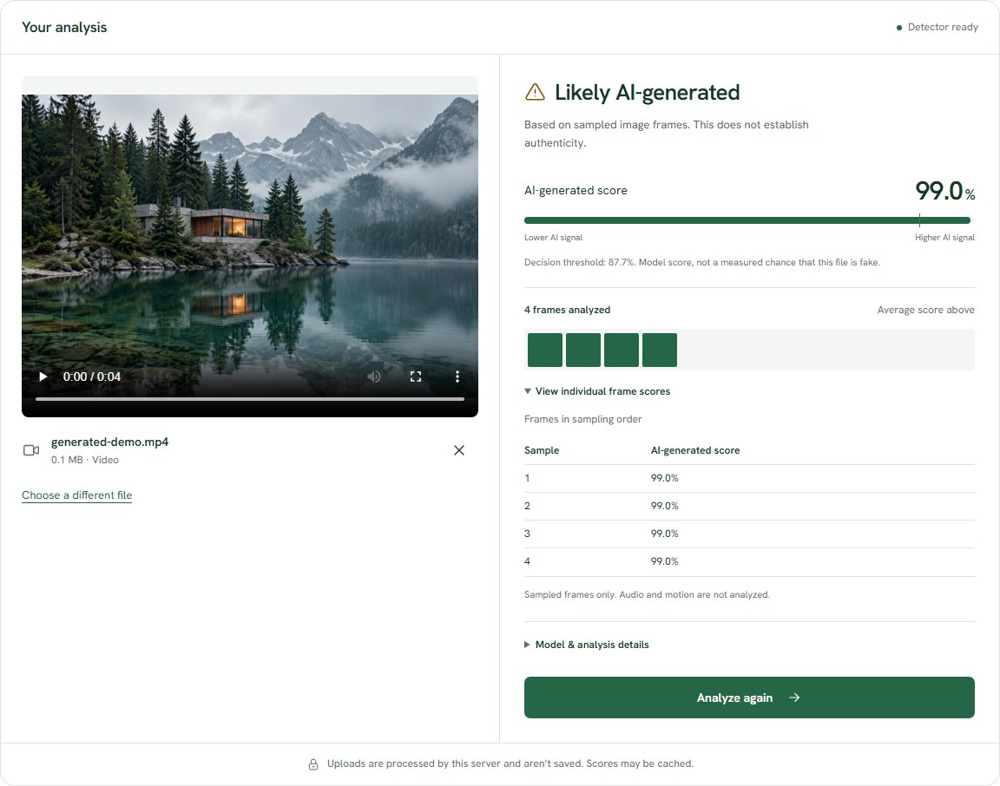

<div align="center">

# Veritas

### Check what you're seeing.

An open source website for checking images and video frames for signs of AI generation.

[](https://github.com/Blasted-ctrl/Veritas/actions/workflows/ci.yml)
[](LICENSE)

[Demo video](docs/demo/veritas-demo.mp4) · [Run locally](#run-it-locally) · [Deploy online](docs/deployment.md) · [Model results](docs/evaluation/artwork-v3/README.md)

</div>

[](https://github.com/Blasted-ctrl/Veritas/raw/refs/heads/main/docs/demo/veritas-demo.mp4)

<p align="center">A preview from the real site. Click to download the full 45-second demo.</p>

**Upload a file. See the prediction. Check the evidence.** Veritas gives you a media preview, an AI class score, the decision cutoff, and the identity of the model behind the result. Videos include scores for each sampled frame.

## Why Veritas exists

AI-generated media can be difficult to recognize. Detection tools make mistakes too, particularly on unfamiliar generators, compressed files, and human-made artwork. Veritas puts the prediction and its limits in the same place, so you can investigate a file without treating a score as proof.

Human-drawn anime, paintings, and digital illustrations are non-AI. Their style alone does not tell you how they were made. That distinction drives our latest CNN training experiment.

## See it working

The captioned demo follows three real uploads: NASA's Earthrise photograph, a labeled AI-generated image, and a four-second clip made from that image. It uses the locally trained artwork CNN. Nothing in the recording intercepts or fabricates model responses.

[Download the MP4](https://github.com/Blasted-ctrl/Veritas/raw/refs/heads/main/docs/demo/veritas-demo.mp4) · [Recording details and sample credits](docs/demo/README.md)



<details>
<summary>More screenshots: upload page and video results</summary>





</details>

## Run it locally

Install [Docker with Compose](https://docs.docker.com/compose/install/), then run:

```sh
git clone https://github.com/Blasted-ctrl/Veritas.git
cd Veritas
docker compose build
docker compose run --rm --no-deps api veritas download-model
docker compose up
```

Open **[localhost:3000](http://localhost:3000)**, choose an image or video, and select **Analyze file**. The first model download is about 328 MiB, is verified by checksum, and stays in a Docker volume. No API key is needed.

**The quickstart downloads the default CIFAKE-trained ViT, not the CNN shown in the demo.** The research CNN is a separate checkpoint with additional training-data restrictions. [Deploy either model](docs/deployment.md#choose-the-model) or [use Python and Node directly](docs/development.md).

## What you get

| Feature                  | What it does                                                                                       |
| :----------------------- | :------------------------------------------------------------------------------------------------- |
| Image analysis           | File preview, AI score, decision cutoff, model details                                             |
| Video analysis           | Sampled-frame scores and their average; up to 32 frames by default                                 |
| A usable website         | Drag and drop, example files, upload progress, cancellation, light and dark themes, mobile layouts |
| Your own backend         | FastAPI and CPU ONNX Runtime; Redis is optional                                                    |
| Training you can inspect | PyTorch CNN/ViT training, separated data splits, evaluation reports, ONNX export                   |

Uploaded media is not retained by the API after processing. Scores, hashes, and optional explanation images can be cached; videos use temporary files that are removed after analysis. [Hosting and data handling](docs/deployment.md#data-and-hosting).

## How much should you trust it?

**A percentage is a model class score, not a calibrated probability or proof of origin.** Check the original source and other evidence before drawing a conclusion. Videos are assessed through sampled still frames; the website does not analyze motion or audio.

Our artwork CNN was trained on human illustrations and paintings alongside AI artwork. On the same 256 held-out artwork images at a 0.5 decision cutoff:

| Measure                                 | Downloadable default ViT | Artwork CNN |
| :-------------------------------------- | -----------------------: | ----------: |
| Human artwork incorrectly flagged as AI |                    68.0% |       10.9% |
| AI artwork detected                     |                    88.3% |       87.5% |

Across the full 512-image test, the CNN reached **80.1% accuracy at 0.5**. The 95% goal has not been reached. Its conservative demo cutoff of 87.7% reduces false alarms but misses more AI: overall test accuracy is 69.7%, with 46.1% AI recall. Photography also regressed against the previous CNN.

The default detector can falsely flag genuine photographs and human-made artwork. In an earlier check it scored NASA's real Earthrise photo about 89.5% AI-generated. The CNN scores the same sample about 9.7%. These individual examples are demonstrations, not a benchmark.

[Read the full artwork evaluation](docs/evaluation/artwork-v3/README.md) · [Model source and limitations](docs/model.md)

## Put it online

[The deployment guide](docs/deployment.md) walks through **Render** and a **Linux server with Docker and automatic HTTPS**. It covers domain setup, frontend/API URLs, installing the research CNN, health checks, updates, and rollback. Hosting requires your own account or server.

## Develop and train

The frontend uses Next.js and React. The Python API runs exported ONNX models; training uses PyTorch.

- [Development, setup, and verification](docs/development.md)
- [Train and export the CNN](docs/cnn-training.md)
- [Artwork experiment](docs/evaluation/artwork-v3/README.md) and [earlier diverse-data experiment](docs/evaluation/diverse-v2/README.md)
- [API endpoints and deployment](docs/deployment.md#api-reference)

## License and credits

Project code is [MIT](LICENSE). The downloadable default model is Apache-2.0. The artwork CNN inherits research/noncommercial training-data restrictions; the code license does not grant rights to every model or dataset. [Sample media credits](frontend/public/samples/credits.json) and [font license](frontend/public/fonts/OFL.txt) are included.
