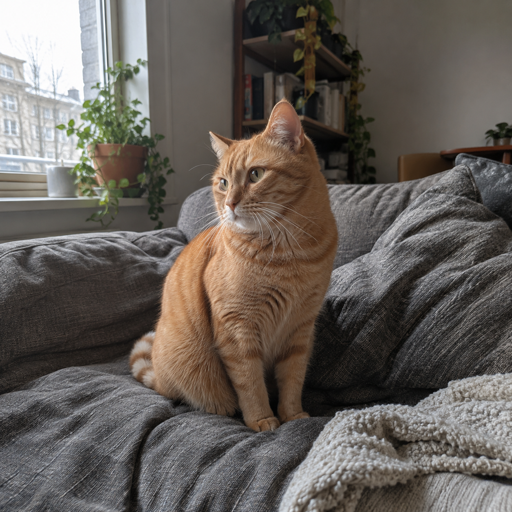

# CNN evaluations

## Diverse-data update

The [larger EfficientNet-B0 experiment](diverse-v2/README.md) trained on 4,096 public images with separate tuning, threshold calibration, same-distribution test and generator/source holdout sets. On the 1,024-image primary holdout at threshold 0.5, new/old CNN accuracy was **73.34% / 47.66%**, and real-image false alarms were **14.45% / 69.73%**.

The **95% target was not reached**. The conservative new-CNN threshold gave **1.37%** false alarms but only **23.63%** AI recall and **61.13%** accuracy. See the report for both policies, confidence intervals, per-generator results, and every prediction. These are paired results on identical examples, not a direct comparison with the smaller pilot below.

## CNN pilot and fixed challenge

The PyTorch ConvNeXt-Tiny pilot correctly classified 53 of 64 held-out CIFAKE images at threshold 0.5. It flagged all 32 generated images, but also falsely flagged **11 of 32 genuine images**. That false-positive rate is too high to promote this pilot as the website's default detector.

### What was measured

Training used 128 images, validation used 32, and test used 64. The two-epoch configuration and threshold were fixed before test evaluation. Checkpoint selection used validation ROC-AUC. The recorded metrics identify the completed checkpoint state. This was a fixed-configuration pilot, not a hyperparameter search.

The data came from the [CIFAKE author's repository](https://github.com/jordan-bird/CIFAKE-Real-and-AI-Generated-Synthetic-Images/tree/e112a942abaecd02b6b1f6f646c807d56be8fb62). Its fake images use Stable Diffusion v1.4, and its genuine images come from CIFAR-10. The [CIFAKE paper](https://arxiv.org/abs/2303.14126) describes the collection. Images are only 32×32 pixels. This seeded subset came from bounded GitHub directory listings; it is not a uniform sample of the whole dataset or a benchmark of modern generators.

The importer verified Git blob identities. Preflight found no shared declared groups, encoded files or decoded RGB images across splits. Content-based group IDs do not establish human identities, and exact hashes do not detect near duplicates.

| Test version, same 64 images | Accuracy | Genuine-image false-positive rate | ROC-AUC |
| --- | ---: | ---: | ---: |
| original | 82.8% | 34.4% | 0.9209 |
| jpeg75 | 82.8% | 34.4% | 0.9189 |
| downscale50 | 68.8% | 43.8% | 0.8223 |

The half-resolution variant reduces the original 32-pixel images to 16 pixels before the serving resize. It shows a substantial loss of performance. Variants reuse the same examples and are not independent test samples.

Training used ImageNet-initialized ConvNeXt-Tiny, AdamW, cross-entropy, head warmup and one unfrozen top stage. It ran on CPU with seed 1337 and batch size 4. [Training metrics and configuration](cnn-pilot-training.json), [dataset audit](cnn-pilot-audit.json), [source selection](cnn-pilot-data.json), [runtime and initialization hash](cnn-pilot-runtime.json), and [ONNX predictions for every test image and variant](cnn-pilot-onnx.json) are recorded. The ONNX evaluation reproduced the Torch test confusion matrix.

### Fresh generated image and fixed examples

The cat was generated specifically as a held-out diagnostic. Its [exact prompt and provenance](challenge/openai-cat.png.json) include the original asset hash. The image tool did not expose a generator version, so only its family is recorded. No challenge image entered the pilot's training or validation data. The three examples were fixed before inspecting the CNN's predictions.

| Example | Known origin | CNN AI-class score | Default ViT AI-class score |
| --- | --- | ---: | ---: |
| Fresh generated cat | AI-generated | 59.4% | 80.8% |
| Generated lakehouse | AI-generated | 66.5% | 98.8% |
| NASA Earthrise photograph | Genuine | 30.9% | 89.5% |

At threshold 0.5, the CNN classified these three examples correctly. The default ViT falsely flagged Earthrise.

Three diagnostic examples cannot estimate general accuracy or establish that the CNN is better. These are model class scores, not calibrated probabilities of authenticity. The default model's upstream CIFAKE train/test overlap is unknown, so a CIFAKE comparison would not establish an unbiased winner either.

Both detectors used the [same manifest](challenge/test.csv) and the API's real processor. The [CNN report](challenge-cnn.json) and [default ViT report](challenge-default-vit.json) include the original, JPEG quality 75 and half-resolution scores. Both reports check separation from the pilot's train/validation groups and exact pixels; that check says nothing about undisclosed upstream training data. [Existing sample credits](../../frontend/public/samples/credits.json) identify the lakehouse and NASA photograph.

### Serving verification

The completed CNN was also tested through an isolated API configured with VERITAS_IMAGE_MODEL. All eight [HTTP smoke cases](cnn-pilot-http.json) passed: image inference, requests without CNN heatmaps, repeated cached requests, corrupt-image rejection, and actual MP4/GIF frame averages. The test used a high sampling rate and an eight-frame cap to exercise the frame path. These are spatial frame checks.

[PyTorch/ONNX parity](cnn-pilot-parity.json) on the raw generated-cat pixels agreed within 2.3×10⁻⁷ in the logits. The [local verification record](verification.json) records 126 passing backend tests, lint, formatting and type checks. Numerical parity and passing software tests do not establish detection accuracy.

### Reproduce

Follow [CNN training and evaluation](../cnn-training.md) to prepare the pinned pilot and export the trained model. From backend, evaluate the fixed examples with:

    veritas evaluate-image --model ../data/models/cnn-pilot/model.onnx --manifest ../docs/evaluation/challenge/test.csv --training-dir ../data/cifake-pilot --output ../data/reports/challenge-cnn.json

Run the same command with the downloaded model to compare its per-image scores. Keep the threshold and examples fixed. The checked-in reports identify the exact graph, processor and manifests used here; newly trained checkpoints can vary with platform and dependency versions. Weights and datasets are not checked into git.
